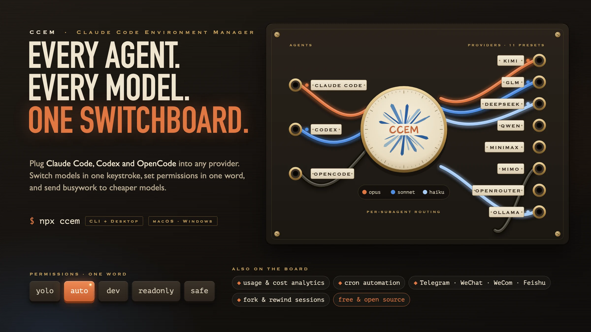
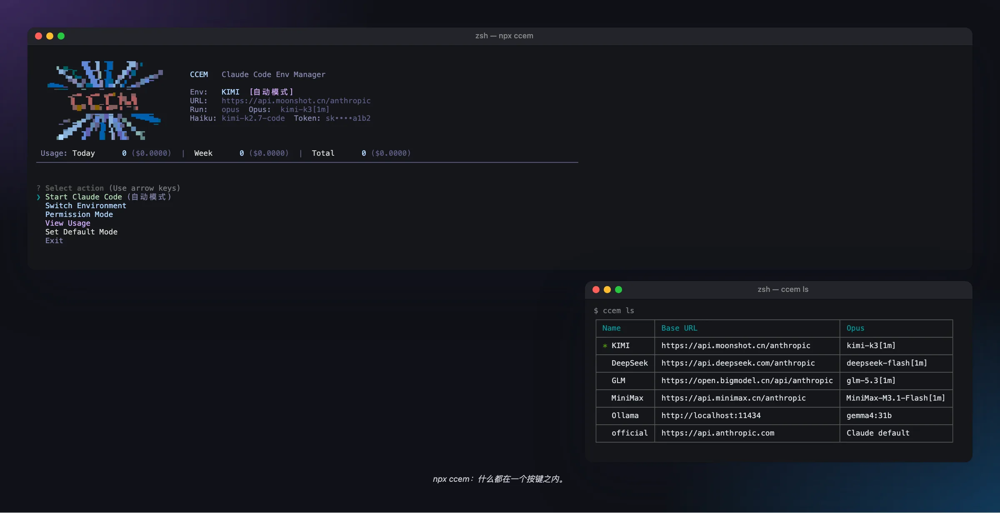
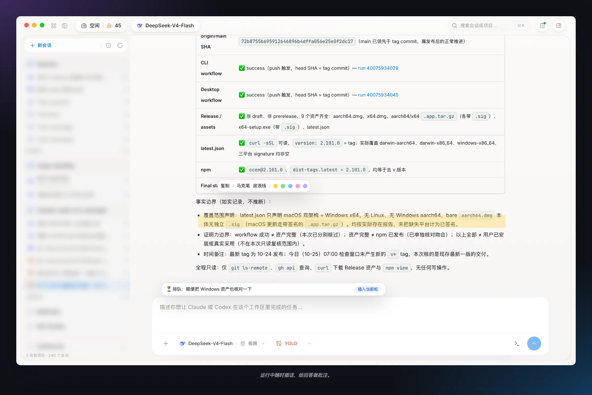
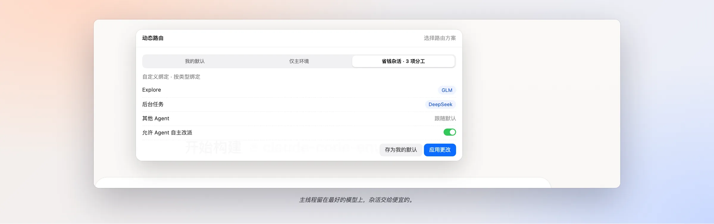
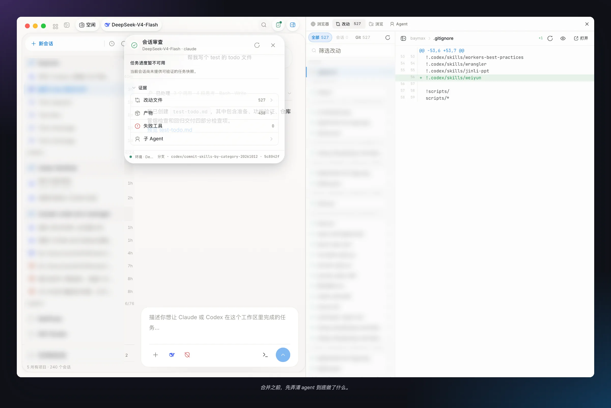
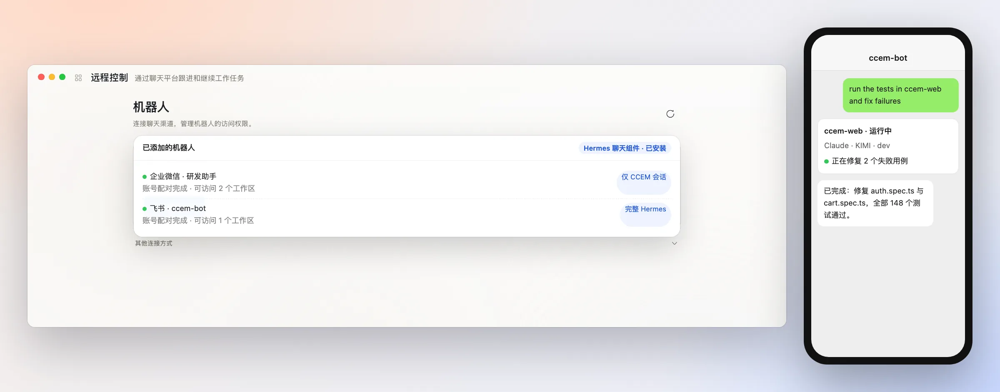
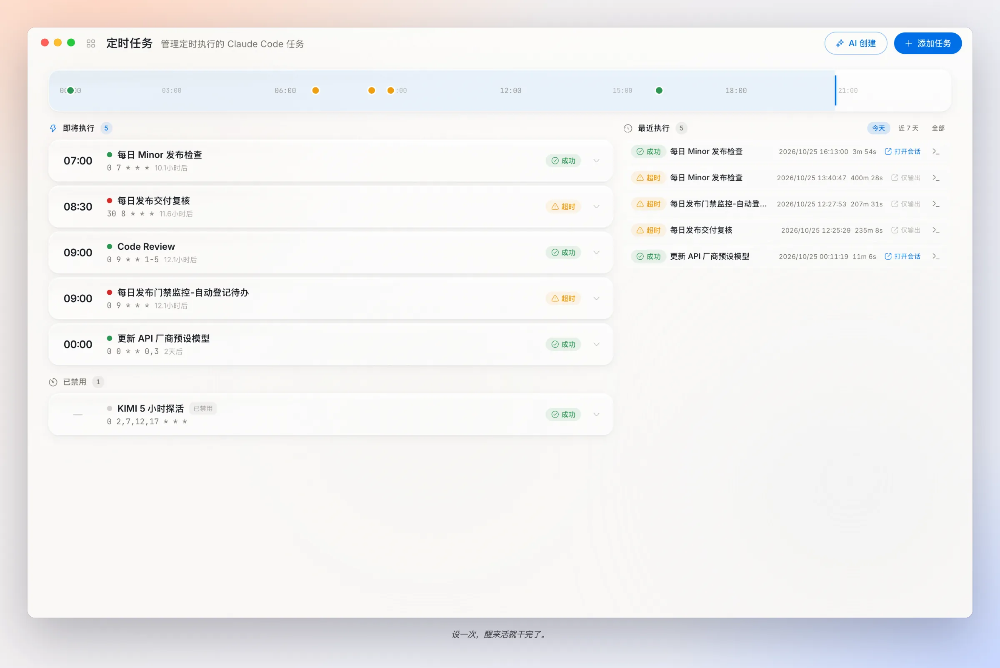
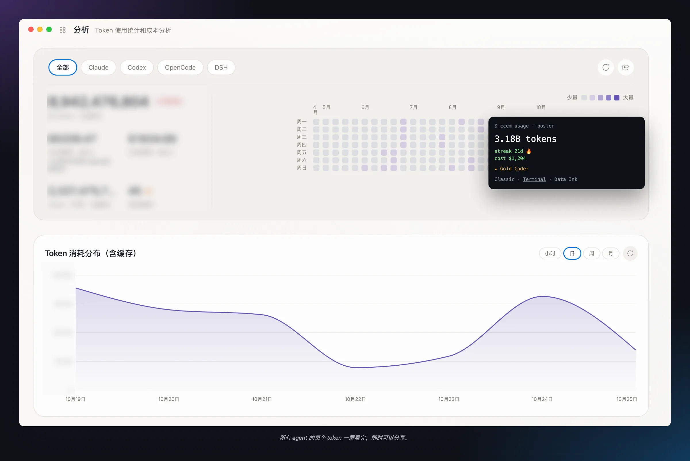
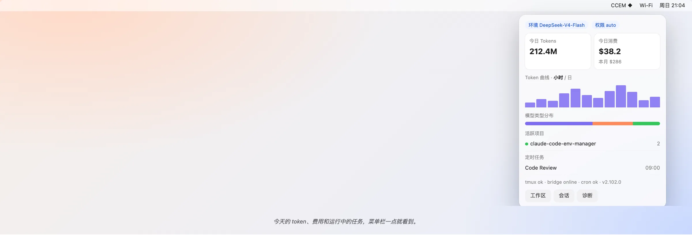

<p align="center">
  
</p>

<h1 align="center">CCEM</h1>
<p align="center"><strong>One control center for Claude Code, Codex, OpenCode and every model behind them.</strong></p>

<p align="center">
  <a href="./README.md">English</a> | <a href="./README_zh.md">中文</a>
</p>

<p align="center">
  <a href="https://www.npmjs.com/package/ccem"></a>
  <a href="https://github.com/Genuifx/ccem/stargazers"></a>
  <a href="https://github.com/Genuifx/ccem/releases"></a>
  <a href="https://github.com/Genuifx/ccem/actions/workflows/release-desktop.yml"></a>
  <a href="https://deepwiki.com/Genuifx/ccem"></a>
  <a href="#license"></a>
  <a href="https://github.com/Genuifx/ccem/pulls"></a>
</p>



---

## Table of Contents

- [Why ccem](#why-ccem)
- [Highlights](#highlights)
- [Quick Start](#quick-start)
- [CLI](#cli)
- [Desktop App](#desktop-app)
- [External Control: JSON-RPC, Deeplinks & CLI](#external-control-json-rpc-deeplinks--cli)
- [How ccem Compares](#how-ccem-compares)
- [Data Storage](#data-storage)
- [Agent Data & Sign-in](#agent-data--sign-in)
- [Tech Stack](#tech-stack)
- [Contributing](#contributing)
- [License](#license)

---

## Why ccem

Claude Code is great. Using it seriously every day is where things get messy.

- **Model sprawl.** KIMI for frontend, DeepSeek for scripts, GLM for refactors, a local Ollama model on the plane. Each switch means hand-`export`ing env vars, and eight terminal tabs later nobody knows which tab talks to which provider.
- **Permission fatigue.** Clicking *Approve* 200 times a day wears you out. `--dangerously-skip-permissions` feels like a bad idea next to your `.env`.
- **No idea what you spent.** Claude Code, Codex and OpenCode each keep their own logs. Nothing adds them up.
- **You're away from your desk.** You're out getting coffee, a test is red, and your laptop is at home.
- **The work that should run itself.** Nightly test runs, a Monday PR sweep, a changelog every Friday, with the results sent to your phone.

**ccem handles all of it.** It's a free, open-source CLI plus a native Tauri desktop app that switches models in one keystroke, sets permissions with one word, routes subagents to cheaper models, tracks every token, runs cron jobs, and lets you continue a session from Telegram, WeChat, WeCom or Feishu.

---

## Highlights

| | CLI | Desktop |
|---|:---:|:---:|
| **11 provider presets** (GLM, KIMI, DeepSeek, Qwen/Bailian, MiniMax, MiMo, OpenRouter, Ollama, …) with Opus / Sonnet / Haiku tier mapping | ✅ | ✅ |
| **5 permission modes**: `yolo` · `auto` · `dev` · `readonly` · `safe` | ✅ | ✅ |
| **Separate agent profiles**: CCEM's Claude Code data stays apart from the official app; Codex can opt in | ✅ `ccem auth` | ✅ |
| **Usage & cost analytics** with a calendar heatmap | ✅ | ✅ Claude + Codex + OpenCode |
| **Skill installer**: 20 curated presets + any GitHub URL | ✅ | ✅ Streaming search |
| **Encrypted team config sharing** (`ccem load`) | ✅ | ✅ |
| **DeepSeek Harness (`dsh`)**: run a ccem environment through DeepSeek's agent harness | ✅ `ccem dsh` | ✅ History source |
| **tmux-backed sessions**: list and attach from any terminal | ✅ `ccem sessions` / `attach` | ✅ |
| **Cron automation**: create, list, delete, trigger | ✅ | ✅ Scheduler, templates, AI generation, run history |
| **Drive Desktop from scripts**: sessions, input, events, routing | ✅ `ccem desktop …` | ✅ 20-method JSON-RPC |
| **Three agents in one workspace**: Claude Code, Codex, OpenCode | — | ✅ |
| **Per-subagent model routing** through a local routing proxy | — | ✅ |
| **Built-in browser side panel** the agent can drive, with you able to pause it | — | ✅ |
| **Steer a running turn**, **fork from any turn** and **rewind to file checkpoints** | — | ✅ |
| **Session Review**: diffs, todos, artifacts, subagent traces | — | ✅ |
| **Chat bots**: Hermes-powered WeCom & Feishu, plus Telegram / WeChat / WeCom bridges | — | ✅ |
| **Tray cockpit**, **Proxy Debug**, **share posters**, **auto-update** | — | ✅ |

The CLI and Desktop read the same config file (`~/.ccem/config.json`), so an environment you add in one shows up in the other immediately.

---

## Quick Start

### CLI: 30 seconds, no install

```bash
npx ccem              # Interactive menu
```

Or install it globally:

```bash
npm install -g ccem
ccem add kimi         # Name it, pick the KIMI preset, paste your key
ccem use kimi         # Switch to it
ccem dev              # Launch Claude Code in "dev" permission mode
```

### Desktop

Download from [GitHub Releases](https://github.com/Genuifx/ccem/releases):

- **macOS**: `.dmg` for Apple Silicon (`aarch64`) and Intel (`x86_64`)
- **Windows**: `.exe` installer (x64)

Open it, add an environment, pick **Claude**, **Codex** or **OpenCode**, describe your task, and press <kbd>Cmd</kbd>+<kbd>Enter</kbd>.

---

# CLI

Everything you need from the terminal: environments, permissions, usage, skills, cron, DeepSeek Harness, tmux sessions, and remote control of a running Desktop app.

## Install

```bash
npm install -g ccem
# or: pnpm add -g ccem
# or just: npx ccem
```



## Environment Management

```bash
ccem              # Interactive menu
ccem add kimi     # Name an environment, then choose a preset or enter settings
ccem use kimi     # Switch environment
ccem ls           # List all environments
ccem current      # Show active environment
ccem env          # Print export commands (pipe-friendly)
ccem env --json   # Same, as JSON
ccem run <cmd>    # Run any command with the env vars injected
ccem del <name>   # Delete
ccem rename <a> <b>
ccem cp <src> <dst>
```

### Built-in Presets

Each preset fills in the base URL and maps Claude Code's **Opus / Sonnet / Haiku** tiers to that provider's models (`ANTHROPIC_DEFAULT_OPUS_MODEL`, `…_SONNET_MODEL`, `…_HAIKU_MODEL`), with `ANTHROPIC_MODEL=opus`. Claude Code's `/model` picker and its subagents then use the right model for each tier.

| Preset | Base URL | Opus tier | Sonnet tier | Haiku tier |
|---|---|---|---|---|
| GLM (Zhipu) | `https://open.bigmodel.cn/api/anthropic` | glm-5.3[1m] | glm-5.3[1m] | glm-5.3-flash |
| KIMI (Moonshot) | `https://api.moonshot.cn/anthropic` | kimi-k3[1m] | kimi-k3[1m] | kimi-k2.7-code |
| Kimi Code Plan | `https://api.kimi.com/coding/` | k3[1m] | k3[1m] | k3[1m] |
| MiniMax | `https://api.minimax.cn/anthropic` | MiniMax-M3.1-Flash[1m] | MiniMax-M3.1-Flash[1m] | MiniMax-M3.1-Flash[1m] |
| DeepSeek | `https://api.deepseek.com/anthropic` | deepseek-flash[1m] | deepseek-flash[1m] | deepseek-flash |
| Bailian (Aliyun) | `https://dashscope.aliyuncs.com/apps/anthropic` | qwen3.7-max | qwen3.7-max | qwen3.6-flash |
| Bailian Coding Plan | `https://coding.dashscope.aliyuncs.com/apps/anthropic` | qwen3.7-plus | qwen3.7-plus | qwen3.7-plus |
| OpenRouter | `https://openrouter.ai/api` | ~anthropic/claude-opus-latest[1m] | ~anthropic/claude-sonnet-latest[1m] | ~anthropic/claude-haiku-latest |
| Ollama (local) | `http://localhost:11434` | gemma4:31b | gemma4:26b | gemma4:e4b |
| MiMo (Xiaomi) | `https://api.xiaomimimo.com/anthropic` | mimo-v2.6-pro | mimo-v2.6-pro | mimo-v2.6-pro |
| MiMo Token Plan | `https://token-plan-cn.xiaomimimo.com/anthropic` | mimo-v2.6-pro | mimo-v2.6-pro | mimo-v2.6-pro |

Any other Anthropic-compatible endpoint works too: just enter the base URL, key and models yourself. API keys are encrypted at rest.

### Shell Integration

`ccem use` can't change the env vars of the shell you're already in. Either prefix commands with `ccem run`, or add this to `~/.zshrc`:

```bash
ccem() {
  command ccem "$@"
  local exit_code=$?
  if [[ $exit_code -eq 0 ]]; then
    if [[ "$1" == "use" || -z "$1" ]]; then
      eval "$(command ccem env)"
    fi
  fi
  return $exit_code
}
```

Then `source ~/.zshrc`.

## Permission Modes

Five presets that sit between "approve everything" and "approve nothing".

| Mode | What it allows | Use it for |
|---|---|---|
| **yolo** | Everything | Your own project, full trust |
| **auto** | The model judges each action's risk and lets low-risk ones through (Claude Code's Auto mode) | Long runs where you don't want to babysit approvals |
| **dev** | Normal development, sensitive files blocked | Daily work |
| **readonly** | Reading and searching only | Code review, audits, learning a codebase |
| **safe** | Restricted network and writes | Unfamiliar or untrusted repos, automation |

```bash
ccem yolo | auto | dev | readonly | safe           # Apply temporarily; reverted when Claude Code exits
ccem setup perms --dev                           # Write it into the project's .claude/settings.json
ccem setup default-mode --dev                    # Make it the default
ccem --mode                                      # Show the current mode
ccem --list-modes                                # Show all modes
```

The retired `ci` and `audit` modes still resolve: saved defaults and API callers that use them get `safe` and `readonly`.

## Usage Analytics

```bash
ccem usage          # Interactive view with a calendar heatmap
ccem usage --json   # Machine-readable
```

ccem parses Claude Code's JSONL logs from the CCEM profile (`~/.ccem/agents/claude/projects/`) and the official `~/.claude/projects/`, and calculates tokens and cost from cached LiteLLM model prices.

## Skill Management

```bash
ccem skill add              # Interactive picker (Tab switches groups)
ccem skill add <name>       # Install a preset
ccem skill add <github-url> # Install from any GitHub repo or subfolder
ccem skill ls               # List installed skills
ccem skill rm <name>        # Remove
```

**Official presets (16):** frontend-design, skill-creator, web-artifacts-builder, canvas-design, algorithmic-art, theme-factory, mcp-builder, webapp-testing, pdf, docx, pptx, xlsx, brand-guidelines, doc-coauthoring, internal-comms, slack-gif-creator

**Curated community skills:** superpowers, ui-ux-pro-max, Humanizer-zh, skill-writer

ccem also ships skills that teach Claude Code to use ccem itself:

```bash
ccem setup cron       # Installs the ccem-cron skill: Claude can schedule tasks for you
ccem setup bot-bind   # Installs the ccem-bot-bind skill: Claude can attach a session to a chat bot
```

## Agent Profiles & Sign-in

Claude Code launched through ccem uses its own profile, so your official Claude Code setup is left alone. Codex shares the official profile by default. See [Agent Data & Sign-in](#agent-data--sign-in) for details.

```bash
ccem auth claude      # Sign in to the CCEM Claude Code profile (for an official subscription)
ccem auth codex       # Sign in to whichever Codex profile is selected
```

API keys from your ccem environments work without signing in.

## DeepSeek Harness (`dsh`)

Run a ccem environment through **DeepSeek Harness**, a separate agent runtime. ccem converts your environment into a dsh provider config, mapping the Opus/Sonnet/Haiku tiers to models, so the same keys work in both runtimes.

```bash
ccem dsh doctor                       # Offline readiness check: binary, versions, config
ccem dsh inspect --env deepseek       # Preview the dsh provider config (secrets redacted)
ccem dsh run --tier sonnet "fix the flaky test in auth.spec.ts"
```

`run` accepts `--env`, `--tier opus|sonnet|haiku`, `--model`, `--cwd` and `--permission read-only|workspace-write|danger-full-access`. Desktop release builds bundle dsh, and its sessions appear in the History page under **DeepSeek**.

## tmux Sessions

When tmux is installed, interactive sessions run inside tmux, so you can pick them up from any terminal:

```bash
ccem sessions         # List tmux-backed interactive sessions
ccem attach [id]      # Attach to one in your terminal
```

## Team Config Sharing

Distribute API configurations to your team over an encrypted channel:

```bash
ccem load https://your-server.com/api/env --key YOUR_KEY --secret YOUR_SECRET
# or keep secrets out of shell history:
echo '{"key":"…","secret":"…"}' | ccem load https://your-server.com/api/env --credentials-stdin
```

A ready-to-deploy server lives in [`server/`](./server). It uses AES-256-GCM authenticated envelopes and rate limiting, and ships with an example config and a PM2 ecosystem file.

## Scheduled Tasks from the CLI

```bash
ccem cron create --name weekday-review --schedule '0 9 * * 1-5' \
  --prompt 'Inspect this project and summarize issues that need attention' \
  --execution-profile conservative --disabled --json
ccem cron list --json
ccem cron trigger weekday-review      # Run it now via the running Desktop app
ccem cron delete weekday-review
ccem cron notification-targets        # Show where results can be delivered
```

Other options: `--working-dir`, `--env-name`, `--max-budget-usd`, `--allowed-tools`, `--disallowed-tools`, `--timeout-secs`, `--template-id`, `--from-json`, and `--wecom-result` / `--wecom-bot-id` / `--wecom-peer-id` to send results to WeCom. Scheduled runs fire from the Desktop scheduler. The CLI writes the task record, and `trigger` asks the running Desktop to run it.

## Drive Desktop from the CLI

With the Desktop app running:

```bash
ccem desktop health --json
ccem desktop create --env kimi --perm dev --json      # Start a workspace session
ccem desktop sessions --cwd . --status running --json
ccem desktop status <runtimeId> --json
ccem desktop events <runtimeId> --since 0 --limit 50 --json
ccem desktop send <runtimeId> --text "now add tests"   # Send input, idempotent with --message-id
ccem desktop routes <runtimeId> --set Explore=glm      # Re-bind a routing key mid-session
ccem desktop open 'ccem://workspace/session?…'         # Focus a session in Desktop
```

## CLI Command Reference

<details>
<summary><b>All commands</b></summary>

| Command | Description |
|---|---|
| `ccem` | Interactive menu |
| `ccem ls` / `use <name>` / `add <name>` / `del <name>` | List, switch, add, delete environments |
| `ccem rename <a> <b>` / `cp <src> <dst>` | Rename / copy an environment |
| `ccem current` | Show active environment |
| `ccem env [--json]` | Print env vars |
| `ccem run <cmd>` | Run a command with env vars injected |
| `ccem load <url>` | Load encrypted remote config |
| `ccem yolo/auto/dev/readonly/safe` | Launch Claude Code with a permission mode |
| `ccem auth claude\|codex` | Sign in to the CCEM agent profile |
| `ccem --mode` / `--list-modes` | Current mode / all modes |
| `ccem setup perms --<mode>` / `--reset` | Write project permissions |
| `ccem setup default-mode --<mode>` | Set the default mode |
| `ccem setup init [--chrome]` | Initialize Claude Code (skip onboarding, disable telemetry; optionally add chrome-devtools MCP) |
| `ccem setup migrate [--clean] [--force]` | Migrate legacy config |
| `ccem setup cron` / `setup bot-bind` | Install the ccem-cron / ccem-bot-bind skills |
| `ccem usage [--json]` | Usage stats |
| `ccem skill add/ls/rm` | Skill management |
| `ccem dsh run/inspect/doctor` | DeepSeek Harness integration |
| `ccem sessions` / `attach [id]` | tmux-backed interactive sessions |
| `ccem bot-bind` | Bind the current session to a chat-bot target |
| `ccem cron create/list/delete/trigger/notification-targets` | Scheduled tasks |
| `ccem desktop health/create/sessions/status/events/send/routes/open` | Control a running Desktop app |

</details>

---

# Desktop App

A native app built on **Tauri 2** (a Rust backend and a React frontend, not an Electron wrapper) for **macOS** and **Windows**. Everything the CLI does, plus a full workspace for running agents.

## Workspace: Claude Code, Codex & OpenCode in One Place



The Workspace isn't just a launcher. It's where you start, steer and review agent runs.

- **Three agents**: start a **Claude Code**, **Codex** or **OpenCode** session from the same composer. Claude and Codex run in the native GUI. OpenCode sessions open in OpenCode Web.
- **A detailed composer**: `$skill` tokens, `/slash` commands (scanned from your installed Claude Code commands and `.claude/commands/`), `@file` mentions, image and file drops, and model, provider and effort selectors.
- **Steer mid-turn**: send a message while Claude is working and it is delivered into the running turn without an interrupt. **Stop** still cancels.
- **Todo card & next steps**: the agent's todo list stays at the bottom of the transcript. When a turn ends, ccem suggests up to two follow-ups that you can run here or as a new session.
- **Annotations**: highlight any part of a reply in five colors and attach notes to it.
- **Fork from any turn**: branch a new Claude session that keeps the full context up to that turn, leaving the original unchanged.
- **File checkpoints & rewind**: restore the working tree to any Claude file checkpoint from the transcript.
- **Built-in browser side panel**: an embedded browser with **isolated login profiles**, so your own Chrome data stays untouched. The agent can drive it. You can pause it, take over, and review its screenshots, console logs and an action audit trail. The same side panel has **Changes**, **Browse** and **Agents** tabs.
- **Global search (<kbd>Cmd</kbd>+<kbd>K</kbd>)**: search every project and past conversation.
- **Hand off to a bot**: attach a running session to a paired chat bot. Hermes decides which updates are worth sending, and replies from chat continue the session.

## Per-Subagent Model Routing



Why pay top-model prices for `grep`? Turn on **Dynamic routing** for a Claude session and ccem runs it through a local routing proxy (bound to `127.0.0.1`) that splits the work across environments:

- Bind **subagent types** (for example `Explore`) and **background tasks** to different environments. The main thread follows the composer's environment.
- Save reusable **route profiles**, or generate them from templates: **Budget chores** (send Explore and the background model to a cheaper environment) or **Specialty split** (bind one subagent type to a specialist).
- Optionally let the agent **re-route itself** to an allow-listed environment.
- Change bindings mid-session. Changes apply from the next request.
- See which environment handled what in the session's **routed usage** breakdown.

Routing is opt-in for each session, and sessions that don't use it run direct. The routing chip in the top bar shows **Direct** or **Routed** and opens the routing popover.

## Sessions & Session Review



- Grid or list view of every session, showing project, environment, permission mode, agent and where it was started (Desktop, CLI, chat bot or cron).
- **Session Review** (the Review icon in the top bar): a todo progress snapshot, changed files from Git and the SDK grouped into per-file diffs, generated artifacts (HTML, images, reports), failed tool calls, and a trace of each subagent.
- **Interactive events** for tmux sessions: structured tool prompts, plan reviews and terminal approvals.
- A live token counter while a turn runs, and the average token speed once it finishes.
- Desktop notifications when a task completes or fails, or when a plan, question or permission prompt needs you.

## Remote Control: Chat Bots



Continue workspace tasks from your phone, using **any API key you've configured** rather than only an Anthropic subscription.

**Hermes bots (WeCom & Feishu).** Desktop installs and manages the **Hermes** chat component for you. Scan a QR code to create a bot (or connect an existing one), pair your chat account, then choose which workspaces each bot can reach. Bots can run in **CCEM sessions only** mode, which limits them to ccem session tools in authorized workspaces, or **Full Hermes** mode with web access, skills, memory, local files and commands. Pick the API environment Hermes uses for conversation, and have cron results sent to your chat.

**Other connection methods.** The original bridges are still available:

- **Telegram**: Forum Topics, with each topic bound to a project directory, environment and permission mode. One topic, one long-lived session.
- **WeChat (Weixin)**: private-chat bridge with QR login, a user allowlist, and `/approve` / `/deny` for permission prompts.
- **WeCom**: multi-bot bridge with admin/user separation, group chats and `@mention` triggering.

Remote control works best with tmux installed (resume and multi-terminal workflows).

## Cron: Scheduled Automation



- **Five-field cron** expressions on local time, with a preview of upcoming runs.
- **Quick templates**: PR Review, Test Runner, Doc Generation, Security Audit, Changelog.
- **AI Create**: describe the job in plain language and get a cron expression and prompt back.
- **Execution profiles**:
  - **Conservative**: read, search, edit and write only, with a lower budget and no shell or web.
  - **Standard**: adds Bash and web tools.
  - **Autonomous**: a higher budget and bypassed permissions, for trusted tasks only.
- A per-task **budget cap**, tool allow/deny lists and a timeout.
- **Run history** with status, duration and logs, plus one-click retry.
- **Result notifications** to Telegram, WeCom or Hermes bots.

Scheduled runs need the Desktop app running.

## Analytics: Claude + Codex + OpenCode



- A daily activity heatmap, token and cost trends by model, and streaks and week-over-week trends.
- Switch between **All, Claude, Codex, OpenCode or DSH** (DeepSeek Harness) in one click.
- **Share posters** in three styles (Classic, Terminal, Data Ink), with ranks from Bronze to Legendary Coder.

Costs come from the usage records ccem can read and known model prices. Where a price is missing, ccem shows the known cost and a count of unpriced tokens instead of guessing. Treat these figures as an estimate, not a provider bill.

## Tray Cockpit



A menu-bar mini dashboard showing the current env and permission mode, today's tokens and cost, an hourly or daily trend, the split by model type, active projects, upcoming cron tasks, health checks (tmux, bridge, cron, version) and quick-launch buttons.

## Also in the Box

- **Conversation History**: one place to browse Claude, Codex, OpenCode and DeepSeek Harness conversations, grouped by project, with `/compact` boundaries respected and continue-from-history support.
- **Proxy Debug**: a live request list (method, URL, status, size) with a JSON and SSE-aware detail viewer, and separate upstream URLs for Claude and Codex.
- **Environments & Skills**: visual versions of the CLI features, with one-click presets, remote config sync and streaming skill search.
- **Auto-update**: background downloads on **stable** or **beta** channels, then restart when it's ready.
- **Settings**: light, dark or system theme. Chinese or English. Default permission mode and working directory. Terminal choice: Terminal.app, iTerm2 or Ghostty. Launch at login. Notifications. An AI-enhancement environment. Agent data & sign-in. Dependency checks for the ccem CLI, `claude`, `codex`, OpenCode and tmux.

### Keyboard Shortcuts

| Shortcut | Action |
|---|---|
| <kbd>Cmd</kbd>+<kbd>1</kbd>…<kbd>9</kbd> | Workspace, Sessions, Environments, Skills, History, Cron Tasks, Remote Control, Analytics, Proxy Debug |
| <kbd>Cmd</kbd>+<kbd>Enter</kbd> / <kbd>Cmd</kbd>+<kbd>N</kbd> | Launch session |
| <kbd>Cmd</kbd>+<kbd>K</kbd> | Global search |
| <kbd>Cmd</kbd>+<kbd>B</kbd> | Open navigation / toggle the conversation list |
| <kbd>Cmd</kbd>+<kbd>,</kbd> | Settings |
| <kbd>Cmd</kbd>+<kbd>Q</kbd> | Quit |

---

## External Control: JSON-RPC, Deeplinks & CLI

While Desktop is running, it serves a **token-authenticated JSON-RPC endpoint on `127.0.0.1`**. Its address and token are written to a local control descriptor (`~/.ccem/control.json`; override with `CCEM_CONTROL_FILE`). Scripts, bots and other tools can start and steer sessions through it. The `ccem desktop …` and `ccem cron trigger` commands use the same endpoint.

<details>
<summary><b>All 20 methods</b></summary>

| Area | Methods |
|---|---|
| Health | `ccem.health` |
| Workspace sessions | `ccem.workspace.createSession`, `listSessions`, `getSession`, `getEvents`, `sendInput`, `openSession`, `restartDirect` |
| Session routing | `ccem.workspace.getRouter`, `ccem.workspace.updateRouter` |
| Router | `ccem.router.status`, `ccem.router.getSettings`, `ccem.router.updateSettings` |
| Remote | `ccem.remote.getEvents` |
| Cron | `ccem.cron.list`, `ccem.cron.trigger`, `ccem.cron.notificationTargets` |
| Environments | `ccem.environment.references`, `ccem.environment.rename`, `ccem.environment.delete` |

</details>

**Deeplinks.** `ccem://workspace/session?…` links open and focus a specific session in Desktop, from a chat message, a notification or `ccem desktop open`.

---

## How ccem Compares

| | ccem | Vanilla Claude Code |
|---|---|---|
| Multi-provider switching | 11 presets with tier mapping, CLI + GUI | Manual `export` |
| Permission presets | 5 one-word modes, including Auto | Built-in modes, configured manually |
| Agents | Claude Code, Codex, OpenCode (+ DeepSeek Harness via CLI) | Claude Code |
| Per-subagent model routing | Local routing proxy, profiles, templates | — |
| Remote control | Hermes WeCom/Feishu, Telegram, WeChat, WeCom | — |
| Scheduled automation | Cron with templates, profiles and budgets | — |
| Unified usage analytics | Claude + Codex + OpenCode | — |
| Session review, fork & rewind | Diffs, todos, artifacts, subagent traces | Partial (CLI rewind) |
| External API | 20-method JSON-RPC + `ccem://` deeplinks | — |
| Price | Free & open source | Free CLI |

---

## Data Storage

| Path | Contents |
|---|---|
| `~/.ccem/config.json` | Environments (API keys encrypted) and settings, shared by CLI and Desktop |
| `~/.ccem/agents/claude/` | CCEM's Claude Code profile: config, login, history, memory |
| `~/.codex/` (or `CODEX_HOME`) | Codex profile, shared with the official app by default |
| `~/.ccem/agents/codex/` | Optional isolated Codex profile |
| `~/.ccem/agents/profiles.json` | Codex isolation preference, shared by CLI and Desktop |
| `~/.ccem/cron-tasks.json` | Scheduled tasks |
| `~/.ccem/usage-cache.json` | Usage cache |
| `~/.ccem/model-prices.json` | Model price cache |
| `~/.ccem/control.json` | Local JSON-RPC endpoint descriptor (while Desktop runs) |
| `.claude/settings.json` | Project permission config |
| `~/.claude/skills/`, `.claude/skills/` | Installed skills |

### Agent Data & Sign-in

- **Claude Code** always runs from a CCEM-owned profile. **Codex** reuses the official configuration, login, history and memory unless you turn on **Settings → Agent data & sign-in → Isolate Codex data**. The setting applies to new sessions. Running sessions keep their profile through reconnects and terminal handoff.
- The first time an isolated profile is used, ccem copies your existing conversations and memories into it and keeps the session IDs. Claude plugins are imported too. Credentials, global settings and plugin registries are not copied.
- After that the profiles change independently. If you turn isolation off, the isolated copy stays on disk and is used again if you turn it back on.
- Your ccem API keys work in every profile. An official subscription needs one sign-in for each isolated profile, from Settings or `ccem auth claude` / `ccem auth codex`.
- Finish any sessions started by an older ccem before the first migration so that their last turns are copied. Isolation covers app data only. It doesn't restrict the agent's access to the filesystem. To use a different agent data root, set `CCEM_AGENT_HOME` to an absolute path.

---

## Tech Stack

```
apps/cli/          CLI: Commander + Inquirer + Ink (React for the terminal)
apps/desktop/      Desktop: Tauri 2 + Rust backend + React 18 frontend
packages/core/     Shared presets, types, encryption, routing (Node + browser builds)
server/            Remote config server (Express)
```

A pnpm workspaces monorepo. **Frontend**: Vite, Tailwind CSS, Zustand, shadcn/ui, Recharts, GSAP. **Backend**: Rust on Tauri 2, with macOS window vibrancy. **i18n**: Chinese and English.

Architecture notes for contributors: [Desktop Backend](docs/architecture/desktop-backend.md) · [Desktop Frontend](docs/architecture/desktop-frontend.md) · [Design System](docs/architecture/design-system.md)

---

## Contributing

Issues and PRs are welcome!

```bash
pnpm install
pnpm --filter @ccem/core build   # Build core first
pnpm run dev                     # Dev mode for all packages
pnpm verify                      # Full local CI gate
```

For Desktop, run `cd apps/desktop && pnpm tauri:dev`. See [CLAUDE.md](./CLAUDE.md) for the dev-instance rules.

## License

Apache License 2.0. See [LICENSE](./LICENSE) for the full text.
